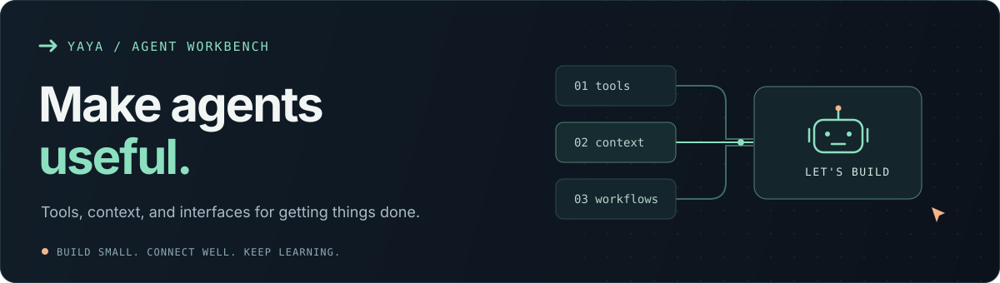

  

### Hi, I'm yaya 🍧

I build **agents, reusable skills, and the interfaces around them**.

最近专注 **Agent 开发**：连接工具、上下文与业务流程，把想法做成能用的应用。

## Selected projects

**[app-harness](https://github.com/yayapao/app-harness)** · Agents inside your app

Business tools, streaming chat, approvals, and session history. Bring your own model and storage.

[Integration skill →](https://github.com/yayapao/app-harness/blob/main/.agents/skills/harness-integrator/SKILL.md)

**[NextPier](https://github.com/yayapao/nextpier)** · Build with coding agents

A Next.js starter with optional app-harness integration and a Wails desktop shell.

[Agent guide →](https://github.com/yayapao/nextpier/blob/main/docs/ai-agent.md)

**[dota2-skill](https://github.com/yayapao/dota2-skill)** · A skill for a game I enjoy

Match history, hero data, and Chinese Dota 2 analysis via OpenDota.

[Skill definition →](https://github.com/yayapao/dota2-skill/blob/main/SKILL.md)

## Current focus

Useful tools, connected context, clear permissions, and interfaces for working with agents.

**TypeScript · React · Next.js · Python · Agent Skills**

Nice to code. Better when it helps. 🍧
