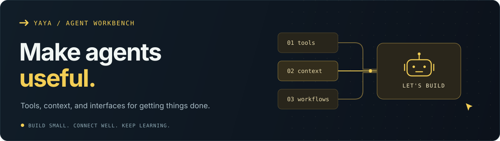

  

### Hi, I'm yaya 🍧

I build **agents, reusable skills, and the interfaces around them**.

最近专注 **Agent 开发**：连接工具、上下文与业务流程，把想法做成能用的应用。

## Selected projects

**[github-gardener](https://github.com/yayapao/github-gardener)** · Care for your GitHub projects

An Agent Skill for repository audits, README improvements, and Profile design.

[Skill definition →](https://github.com/yayapao/github-gardener/blob/main/SKILL.md)

**[lal](https://github.com/yayapao/lal)** · Keep local projects running

A macOS workbench for dev servers and games, with logs, ports, and Git status in one place.

[Download →](https://github.com/yayapao/lal/releases)

**[app-harness](https://github.com/yayapao/app-harness)** · Agents inside your app

Business tools, streaming chat, approvals, and session history. Bring your own model and storage.

[Integration skill →](https://github.com/yayapao/app-harness/blob/main/.agents/skills/harness-integrator/SKILL.md)

## Current focus

Useful tools, connected context, clear permissions, and interfaces for working with agents.

**TypeScript · React · Next.js · Python · Agent Skills**

Nice to code. Better when it helps. 🍧
